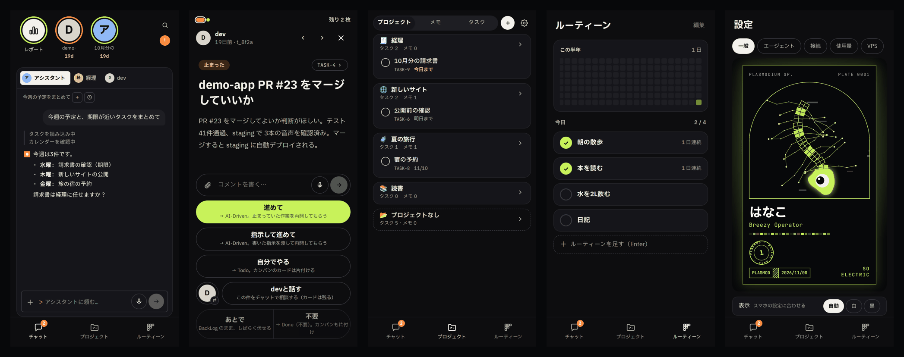
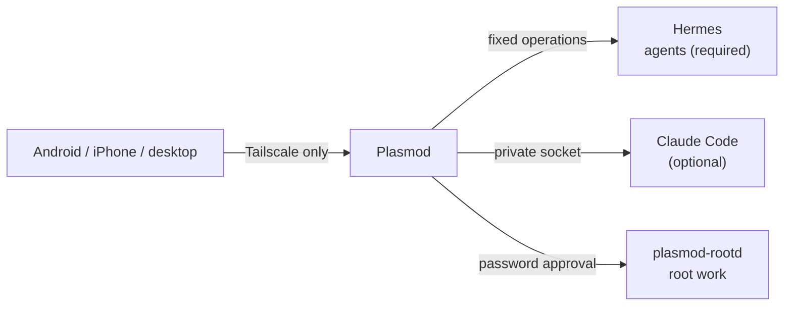

# Plasmod

> (I am large, I contain multitudes.) — Walt Whitman, *Song of Myself*

**Direct a team of AI agents from your phone.** A self-hosted control panel that runs on your own VPS.

A slime mold's *plasmodium* has no brain: many nuclei move as one body. Plasmod works the same way. Your agents act on their own, and you are called only when a decision is needed.



[日本語](README.md) · [Changelog](CHANGELOG.md)

> **Status**: used daily by the author, and not yet verified end to end on anyone else's setup. **The interface and the docs are mostly in Japanese.** Full English support is planned for v4.0.

## What it does

| | |
|---|---|
| **Decision cards** | Blocked work, reviews, tool permissions and replies, answered one card at a time |
| **Chat** | Talk to agents, send photos and files, search past conversations |
| **Tasks** | BackLog, Todo, AI-Driven and Done, with parents, links, tags and due dates |
| **Notes** | Markdown with live preview, projects, tags and history. Works offline |
| **Routines** | Daily habits with a six-month activity graph |
| **Teams** | Group agents your way. Chat, reports and delegation follow |
| **Reports** | A story-style morning summary and scheduled reports |
| **Root approvals** | Agents request root work; you read it and approve with a password |
| **Dev** | Pull requests, checks and deploys (when GitHub is configured) |
| **Settings** | Usage and cost, models, schedules, connections and VPS status |

## Devices

**Android**: the APK from [Releases](../../releases), with actionable notifications. **iPhone**: open in Safari and use Add to Home Screen (iOS 16.4+). **Desktop**: any browser. All of them need Tailscale on.

## How it works



- **Nothing is exposed to the internet.** [Tailscale](https://tailscale.com/) is the only way in
- **OS users separate privileges** for the app, the agents and root work
- **Agents never hold the keys.** You approve root work with a password each time
- **Your data stays on your VPS.** Only push notifications (encrypted) and services you configure leave it

## Install

You need an Ubuntu VPS, [Tailscale](https://tailscale.com/) and [Hermes Agent](https://github.com/NousResearch/hermes-agent).

```sh
git clone https://github.com/LaCall-Gagans-Studio/Plasmod.git plasmod && cd plasmod
sudo ./setup.sh --check   # checks only
sudo ./setup.sh
```

It prints your address when it finishes. A first-run guide opens in the app.

## Authors

- Developer: Touma ([LaCall-Gagans-Studio](https://github.com/LaCall-Gagans-Studio))
- Co-developer: [Mickey0321](https://github.com/Mickey0321)

## License

[MIT](LICENSE)
