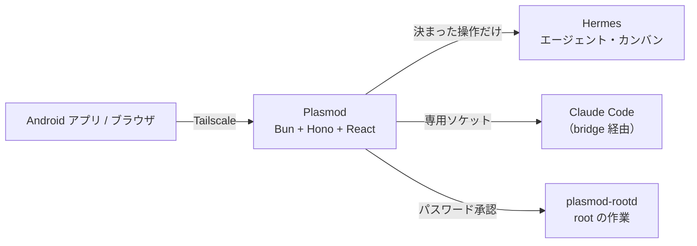

# Plasmod

AI エージェントのチームを、スマホ1台で指揮するためのセルフホスト型コントロールパネル。

エージェントが判断を求めてきたらカードで答え、チャットで頼み、タスクとメモを一緒に使い、VPS の上での稼働を見守る。チャットツールに流れてしまう報告や承認を、1つのアプリに集める。

外のインターネットには口を開けない。入口は [Tailscale](https://tailscale.com/) だけ。

> **状態**: 作者が毎日使っている段階です。入れるコマンドは、まっさらな環境ではまだ試していません。

[English](README.en.md)

## できること

| | |
|---|---|
| **判断カード** | BackLog はすべてタスク。止まった作業・レビュー依頼・仕分け待ち・ツールの実行許可・メールの返信要否を、同じカードで捌く |
| **タスク** | 状態は BackLog／Todo／AI-Driven／Done の4つ。親子・つながり・タグ・期日。任せたタスクは、エージェントの作業が止まると BackLog に戻る |
| **チャット** | エージェントと会話し、写真やファイルを渡す。過去の会話も検索できる |
| **メモ** | Markdown のライブプレビュー、プロジェクトとタグ、変更履歴。オフラインで書けて、あとで同期する |
| **音声メモ** | スマホを机に置いて話し続ける（Android） |
| **root 作業の承認** | エージェントの root 権限の依頼を、差分を見てパスワードで承認する。自分でコマンドも打てる |
| **カンバン・開発** | エージェントの作業の流れ、PR、チェック、デプロイの状況 |
| **レポート** | ストーリー形式の日報と、定期実行の報告 |
| **設定** | 使用量とコスト、モデルの切り替え、定期実行、VPS の状態、ファイルの閲覧（読むだけ） |
| **Android アプリ** | 通知（ボタンでその場で返せる）、ホーム画面のウィジェット、音声メモ |

## しくみ



- **権限を OS のユーザーで分ける。** アプリ・エージェント・root の作業を別のユーザーで動かす。開発エージェントが自分の依頼を自分で承認することはできない
- **鍵をエージェントに渡さない。** 秘密はアプリのユーザーだけが読める設定ファイルに置く。エージェントからの書き込みは、ファイルの持ち主（uid）で誰かを見分ける
- **更新は署名を確かめて入れる（任意）。** root に関わる変更は人の承認を待つ

図と詳しい説明は [docs/ARCHITECTURE.md](docs/ARCHITECTURE.md)。

## Android アプリ

[Releases](../../releases) から `plasmod-v*.apk` を入れる。スマホの Tailscale をオンにして開き、サーバーの住所（`https://<machine>.<tailnet>.ts.net:8443`）を入れる。

画面はサーバーから読むので、画面の更新に APK の入れ直しは要らない。

## ブラウザと iPhone

ブラウザでもそのまま使えます。**設定 → 一般 → 通知** で通知を受け取れます。iPhone は Safari の共有メニューから「ホーム画面に追加」して開くと通知が使えます（iOS 16.4 以降）。どの端末も Tailscale をオンにして開きます。

## 入れる

VPS や Tailscale がまだの方は、[はじめての準備](docs/GETTING-STARTED.md) から始めてください。

要るもの: Ubuntu の VPS、[Tailscale](https://tailscale.com/)（ログイン済み）、[Hermes](https://github.com/NousResearch/hermes-agent)。

```sh
git clone <このリポジトリ> plasmod && cd plasmod
sudo ./setup.sh --check   # 前提を調べるだけ
sudo ./setup.sh
```

終わると住所が出ます。Tailscale につないだ端末で開いてください。呼び名やエージェントの名前は、アプリの設定で変えられます。詳しくは [docs/INSTALL.md](docs/INSTALL.md)。個人の設定はすべて VPS の中に残ります。

## 開発


要るもの: [Bun](https://bun.sh/)。開発ではサンプルのデータで動く。

```sh
bun install
bun run build
PLASMOD_KANBAN_SOURCE=fixture PLASMOD_DEV_NO_AUTH=1 bun run src/server/index.ts   # http://127.0.0.1:8790
bun run dev:web                                                         # 画面だけ（vite）
```


## テスト

```sh
bun test
bunx tsc --noEmit
python3 -m unittest tests/test_broker.py
```

## フォルダ

| 場所 | 中身 |
|---|---|
| `src/server/` | API サーバー |
| `src/web/` | 画面（React + Tailwind の PWA） |
| `src/shared/` | サーバーと画面で共通の型 |
| `broker/` | エージェントの権限で動く仲介（決まった操作だけ） |
| `rootd/` | root 作業の承認と実行（`plasmod-rootd`・`rootreq`） |
| `apk/` | Android アプリ（Capacitor） |
| `deploy/` | 設置の手順と設定 |
| `docs/` | 構成の説明 |

## 名前

Plasmod は、粘菌などの「変形体（plasmodium）」から。形を変えながら広がるイメージです。

## ライセンス

[MIT](LICENSE)
