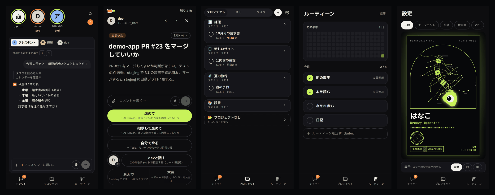
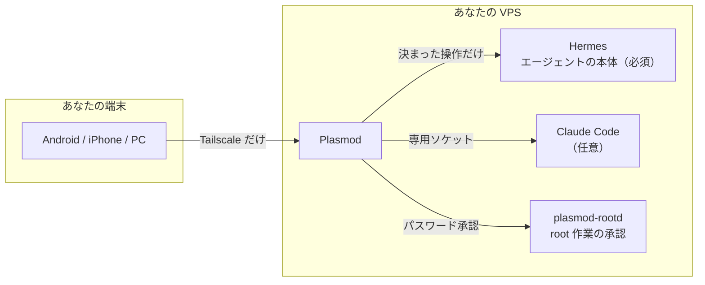

# Plasmod

> わたくしといふ現象は ── 宮沢賢治『春と修羅』

**AI エージェントのチームを、スマホから指揮する。** 自分の VPS で動かす、セルフホストの操作画面です。

粘菌の変形体（plasmodium）は、脳を持たず、たくさんの核がひとつの体で動きます。Plasmod も同じ形をしています。エージェントはそれぞれ動き、あなたは判断が要るところにだけ呼ばれます。



[English](README.en.md) ・ [はじめての準備](docs/GETTING-STARTED.md) ・ [入れ方と運用](docs/INSTALL.md) ・ [構成](docs/ARCHITECTURE.md) ・ [セキュリティ](docs/SECURITY.md) ・ [変更の記録](CHANGELOG.md)

> **状態**: 作者が毎日使っています。作者以外の環境での通し確認は、これからです。画面は日本語です（英語は一部だけ。v4.0 で対応予定）。

## 使うとこうなる

1. エージェントが判断を求めると、**カード**が届きます。スマホの通知からその場で答えられます
2. 頼みたいことは**チャット**で。写真やファイルも渡せます
3. 任せた仕事は**タスク**で追えます。終わると自動で片付きます
4. 朝は**レポート**で、今日のタスク、メモ、ルーティーン、エージェントの報告をまとめて見ます

## できること

| | |
|---|---|
| **判断カード** | 止まった作業、レビュー依頼、ツールの実行許可、返信の要否を、1枚ずつ答える |
| **チャット** | エージェントと会話し、写真やファイルを渡す。過去の会話も検索できる |
| **タスク** | BackLog／Todo／AI-Driven／Done。親子、つながり、タグ、期限順 |
| **メモ** | Markdown のライブプレビュー、プロジェクト、タグ、変更履歴。電波が無くても書ける |
| **ルーティーン** | 毎日の習慣と半年分の草グラフ。レポートからもチェックできる |
| **チーム** | エージェントを自由に分ける。チャット、レポート、任せ先に反映する |
| **レポート** | ストーリー形式の朝のまとめと、定期実行の報告 |
| **root 作業の承認** | エージェントの root の依頼を、差分を見てパスワードで通す |
| **開発** | PR、チェック、デプロイの状況（GitHub を設定したとき） |
| **設定** | 使用量とコスト、モデル、定期実行、接続の状態、VPS の状態 |

## 端末

| | 通知 |
|---|---|
| **Android** | [Releases](../../releases) の APK。ボタンでその場で返せる。ウィジェットと音声メモもある |
| **iPhone** | Safari で「ホーム画面に追加」して開く（iOS 16.4 以降）。押してカードを開く |
| **PC** | ブラウザで開く |

どの端末も Tailscale をオンにして開きます。

## しくみ



- **インターネットに口を開けません。** 入口は [Tailscale](https://tailscale.com/) だけです
- **権限を OS のユーザーで分けます。** アプリ、エージェント、root の作業は別のユーザーで動きます
- **鍵をエージェントに渡しません。** root の作業は、毎回あなたがパスワードで承認します
- **データは自分の VPS にあります。** 外へ出るのは、通知の配信（本文は暗号化）と、あなたが設定したものだけです

詳しくは [docs/SECURITY.md](docs/SECURITY.md) と [docs/ARCHITECTURE.md](docs/ARCHITECTURE.md)。

## 入れる

要るもの: Ubuntu の VPS、[Tailscale](https://tailscale.com/)、[Hermes](https://github.com/NousResearch/hermes-agent)。

VPS を借りるところからは、**[はじめての準備](docs/GETTING-STARTED.md)** に画像つきで書いてあります。すでにあれば:

```sh
git clone https://github.com/LaCall-Gagans-Studio/Plasmod.git plasmod && cd plasmod
sudo ./setup.sh --check   # 前提を調べるだけ
sudo ./setup.sh
```

終わると住所が出ます。開くと初回の案内が始まります。

## 開発

要るもの: [Bun](https://bun.sh/)。開発では見本のデータで動きます。

```sh
bun install
bun run build
PLASMOD_KANBAN_SOURCE=fixture PLASMOD_DEV_NO_AUTH=1 bun run src/server/index.ts   # http://127.0.0.1:8790
bun run dev:web                                                                   # 画面だけ（vite）
```

テストは `bun test`、型は `bunx tsc --noEmit`、そのほかは [CI の定義](.github/workflows/test.yml) を見てください。

| 場所 | 中身 |
|---|---|
| `src/server/` | API サーバー |
| `src/web/` | 画面（React + Tailwind の PWA） |
| `src/shared/` | サーバーと画面で共通の型 |
| `broker/` | エージェントの権限で動く仲介（決まった操作だけ） |
| `rootd/` | root 作業の承認と実行 |
| `bridge/` | Claude Code とつなぐ部品（任意） |
| `apk/` | Android アプリ（Capacitor） |
| `deploy/` | 設置の手順と設定 |

## ライセンス

[MIT](LICENSE)
