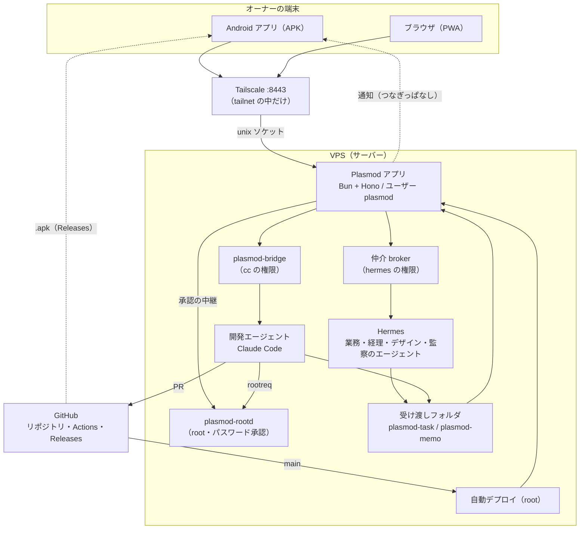
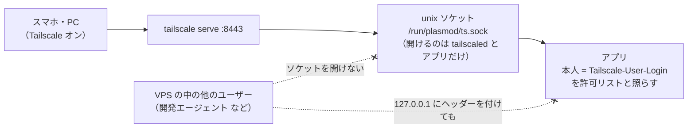
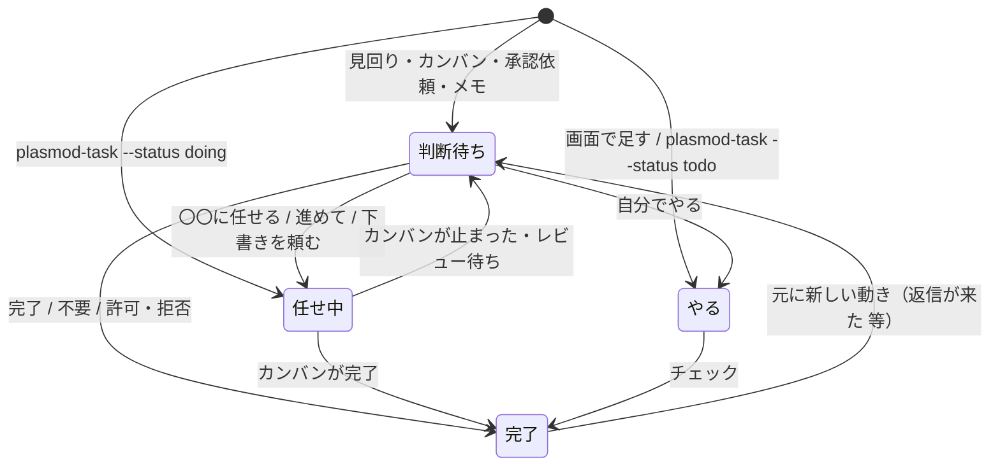
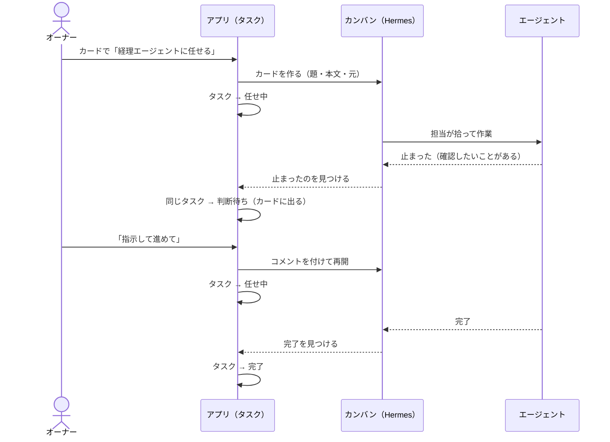
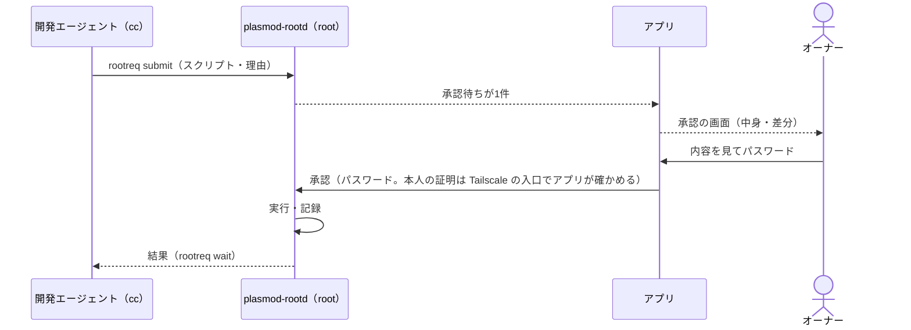
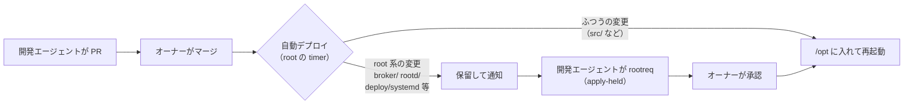
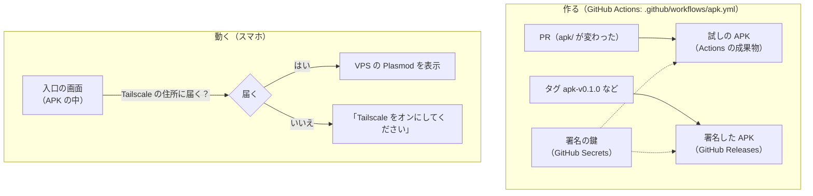

# アーキテクチャ

Plasmod の全体の地図。機能の一覧は [README](../README.md)、設置の手順は [docs/INSTALL.md](../docs/INSTALL.md)。

- [1. 全体図](#1-全体図)
- [2. 入口（どこから入るか）](#2-入口どこから入るか)
- [3. 権限の分け方（誰が何をできるか）](#3-権限の分け方誰が何をできるか)
- [4. タスクとカード](#4-タスクとカード)
- [5. カンバンとの関係](#5-カンバンとの関係)
- [6. root 作業の承認](#6-root-作業の承認)
- [7. 変更が本番に入るまで（デプロイ）](#7-変更が本番に入るまでデプロイ)
- [8. Android アプリ（APK）](#8-android-アプリapk)
- [9. リリース](#9-リリース)
- [10. ファイルの地図](#10-ファイルの地図)

---

## 1. 全体図

ポイント:

- **アプリは司令塔だが、自分では何も実行しない**。カンバンや Hermes を動かすのは仲介（hermes の権限）、開発エージェントとの話は bridge（cc の権限）、root の作業は plasmod-rootd（root）。アプリはそれぞれに「決まった依頼」を渡すだけ
- **エージェントからアプリへの書き込み**（タスクの登録・メモ）は、受け渡しフォルダに依頼ファイルを置く形（`plasmod-task` / `plasmod-memo`）。鍵は使わず、ファイルの持ち主（OS のユーザー）で「誰が書いたか」を決める
- 画面はブラウザでも APK でも同じもの（APK は VPS の画面を表示している）

## 2. 入口（どこから入るか）

| 入口 | 使う人・端末 | 本人確認 | 状態 |
|---|---|---|---|
| **Tailscale**（`https://<machine>.<tailnet>.ts.net:8443`） | スマホの APK・ブラウザ、PC のブラウザ | tailnet の本人（`許可リストのログイン名`）。tailscaled が付ける | 唯一の入口 |

Tailscale の入口のしくみ:

- ソケットから来たリクエストにだけ、アプリの中で「Tailscale から来た」という印を付ける。印はリクエストの中身では作れないので、なりすましできない（`src/server/auth.ts`）
- **VPS 自身から tailnet 越しに来たもの（開発エージェントなど VPS の中のユーザー）は断る**。VPS の端末の持ち主もオーナーなので、そのままだと tailscaled が「オーナー」の名前を付けてしまうため（`X-Forwarded-For` が VPS 自身の住所なら 403）
- root 作業の承認も、Tailscale の入口から（本人＋パスワード）できる

## 3. 権限の分け方（誰が何をできるか）

いちばん大事な設計は「**開発エージェントが自分の依頼を自分で承認できない**」こと。そのために、OS のユーザーを分けている。

| 誰（OS のユーザー） | 何をする | できないこと |
|---|---|---|
| **plasmod**（アプリ） | 画面・API、判断の記録、仲介・bridge・plasmod-rootd への依頼 | コード（/opt）を書き換える、root の作業を直接する |
| **hermes**（Hermes のエージェント） | エージェントたちのカンバン・cron・チャット。仲介はこの権限で動く | アプリの DB を直接さわる（plasmod-task 経由だけ） |
| **cc**（開発エージェント） | 開発・PR、rootreq で root 作業を依頼、plasmod-task | 自分の rootreq を承認する、アプリの DB・設定を読む、仲介を呼ぶ |
| **root**（plasmod-rootd・自動デプロイ） | 承認された root 作業、/opt への反映 | パスワード無しで依頼を実行する |
| **オーナー** | 判断・承認（パスワード）、マージ、外部サービスの設定 | — |

鍵・トークン（GitHub・Hermes の API など）は `/etc/plasmod/env`（root とアプリだけが読める）にだけ置く。

## 4. タスクとカード

**カード＝判断待ちのタスクの見え方**。カードを別に作る処理は無く、何かが起きたら「判断待ちのタスクとして投げる」か「元のタスクを判断待ちに移す」だけ。

### 状態は4つ

| 状態（画面の名前） | 意味 | チャット画面のカード |
|---|---|---|
| Inbox（判断待ち） | オーナーが決める | 出る |
| Todo（やる） | オーナーが自分でやる | 出ない（期日が近いと右の列に出る） |
| AI-Driven（任せ中） | エージェントがカンバンで作業している | 出ない |
| Done（完了） | 終わった。理由が「不要」のものは小さく「不要」と出る | 出ない |

Inbox・Todo・AI-Driven をまとめた絞り込みが BackLog。

### タスクの元

| 元 | どう入るか |
|---|---|
| メール・Beeper・ops の見回り | `plasmod-task add`（同じ元は1件にまとまる。判断は残る）。**判断待ちは問いの形＋3行で書く**（スキル `inbox-card`） |
| カンバンが止まった・レビュー待ち・仕分け待ち | アプリが自動で判断待ちのタスクにする（任せたタスクなら、元のタスクを判断待ちに戻す） |
| 開発エージェントの承認依頼（ツールの実行など） | アプリが自動で判断待ちのタスクにする |
| カードのメモ | 同上 |
| 計画の段・子タスク（開発エージェント） | `plasmod-task add --status doing`（判断待ちにしない） |
| 画面で足す | 「やる」で入る |

カードのボタンは「**押すとどの状態に移るか**」の名前で揃えている（自分でやる／〇〇に任せる／完了／不要／あとで、ほか元に合わせて 進めて・やり直し・許可・拒否 など）。

## 5. カンバンとの関係

カンバン（Hermes）は**エージェントの作業場**、タスクは**オーナーの台帳**。1つのタスクに、エージェントの作業（カンバンのカード）が1枚ぶら下がる（`kanban_id`）。

- エージェントが自分で作ったカンバン（タスクから任せていないもの）が止まったときは、その時点で新しい判断待ちタスクができる
- 作業中・準備OK のカンバンは判断待ちではないので、カードにならない（カンバン、ウォッチングで見る）

## 6. root 作業の承認

開発エージェント（cc）が VPS の root 作業をしたいときは、必ずオーナーのパスワード承認を通る。

- パスワードは保存もログもしない。5回間違えると15分ロック。1つの依頼は1回だけ実行
- 読むだけの調べ（`rootreq inspect`）と、決まった部品（`rootreq action`。差分・控え・元に戻すつき）もある

## 7. 変更が本番に入るまで（デプロイ）

- 自動デプロイは、GitHub の main の commit がオーナーのマージ（署名つき）であることを確かめてから入れる
- 保留中は、それ以降の変更もすべて止まる。マージ後は保留の通知を見て、開発エージェントが apply-held を出す
- 様子は `/var/lib/plasmod-deploy/`（deployed・build.log）

## 8. Android アプリ（APK）

- 中身は Capacitor（`apk/`）。**画面は VPS から読む**ので、画面の更新に APK の作り直しは要らない（マージ → 自動デプロイで APK にも出る）
- APK を作り直すのは、ネイティブの部分（ウィジェット・通知・アイコンなど）を変えたときだけ
- 署名の鍵はオーナーが作って GitHub Secrets に入れた（`APK_KEYSTORE_B64` ほか4つ）。**同じ鍵で署名するので上書きで入れ替えられる**。鍵（`hermes.p12`）をなくすと、アンインストールして入れ直しになる
- アプリの中で開くのは `*.ts.net` の住所だけ。それ以外のリンクは Chrome で開く

## 9. リリース

| 版 | 中身 | 状態 |
|---|---|---|
| v1.0 "Hello My WINGMAN" | Android アプリ、通知、ウィジェット、Tailscale への入口の一本化 | リリース済み（`apk-v1.0.0`） |
| v2.0 | 計画中 | — |

**アプリはインターネットに口を出さない**（tailnet の中だけ）。その代わり Tailscale が唯一の入口になる。端末をなくしたら、Tailscale の管理画面でその端末を外す。

## 10. ファイルの地図

| 場所 | 中身 |
|---|---|
| `src/server/` | アプリのサーバー（Bun + Hono）。`app.ts` と `routes/` API、`hub.ts` 状態の持ち主・判断の実行、`model.ts` カードの組み立て、`tasks.ts` タスク、`auth.ts` 本人確認、`index.ts` 起動（TCP と Tailscale のソケット） |
| `src/web/` | 画面（React + Tailwind の PWA） |
| `src/shared/types.ts` | サーバーと画面で共通の型 |
| `broker/` | 仲介（hermes の権限。カンバン・cron・モデルなど決まった操作だけ） |
| `rootd/` | plasmod-rootd（root の作業の承認と実行）と `rootreq` |
| `apk/` | Android アプリ（Capacitor）。`www/index.html` が入口の画面 |
| `.github/workflows/apk.yml` | APK のビルドと Release |
| `docs/INSTALL.md` | 入れ方と運用 |
| `deploy/autodeploy/` | 自動デプロイ |
| `deploy/memo-spool/` | `plasmod-task` / `plasmod-memo`（エージェントからアプリへの受け渡し） |
| `deploy/hermes-skills/` | Hermes のスキル（`inbox-card` など） |
| `deploy/tailscale/` | Tailscale の入口の設置 |
| `bridge/` | 開発エージェントとアプリをつなぐ bridge の本体とテスト |
| `tests/` | テスト（`bun test`） |
