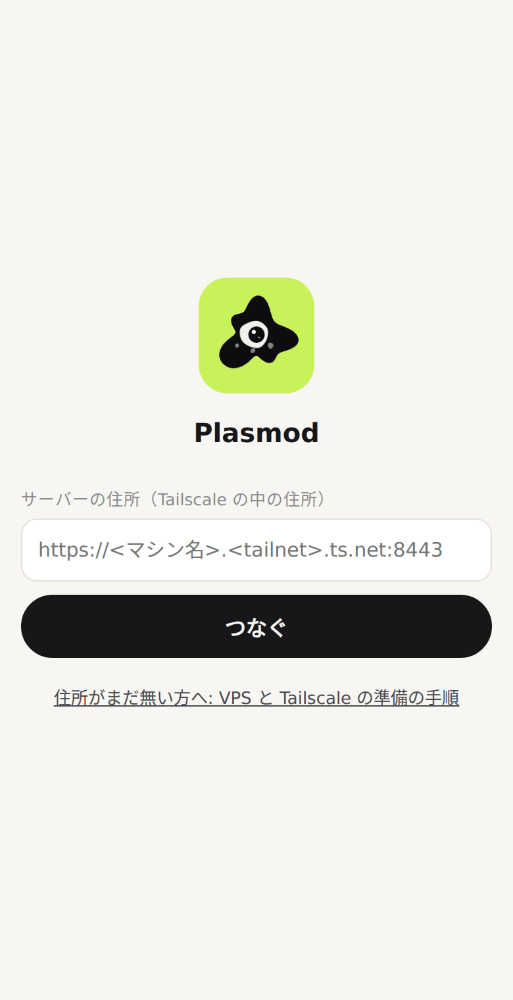
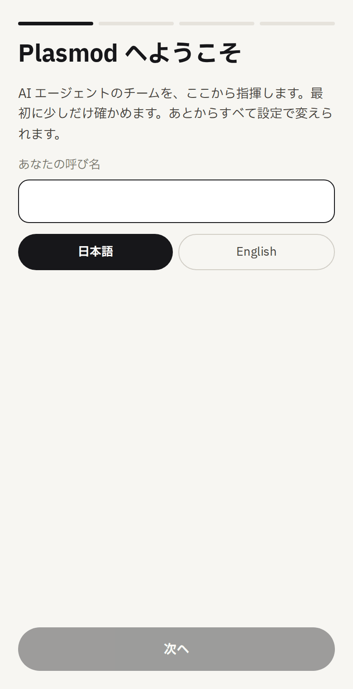
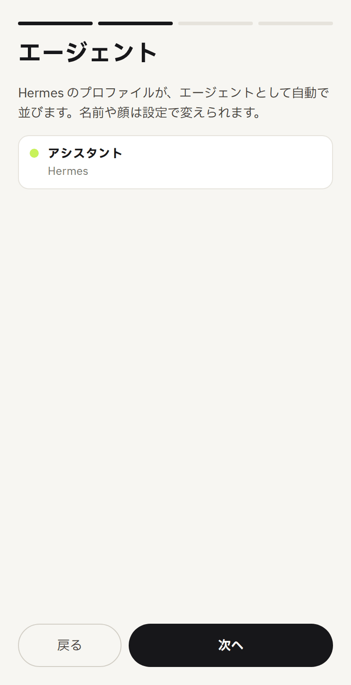
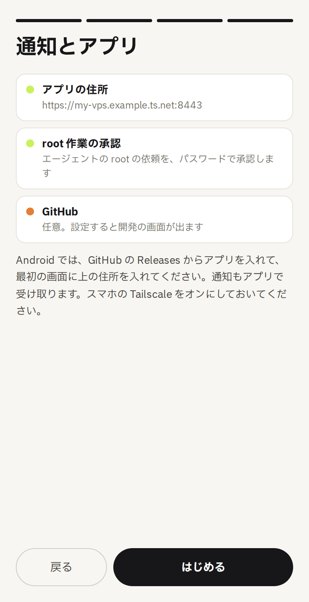
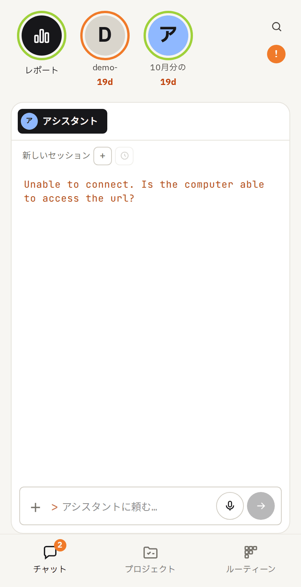

# はじめての準備

VPS を借りるところから、スマホで Plasmod を開くまでの手順です。Linux のサーバーを触ったことがある方なら、1時間ほどで終わります。

> **この手順書の状態**: 作者以外の環境での通し確認は、これからです。詰まったところがあれば、[Issue](https://github.com/LaCall-Gagans-Studio/Plasmod/issues) で教えてください。

## 全体の形

```
スマホ・PC ──(Tailscale)── VPS
                            ├─ Plasmod（この画面）
                            └─ Hermes（AI エージェント）
```

- **VPS**: 24時間動く、借りたサーバーです。エージェントはここで動きます
- **Tailscale**: 自分の端末どうしだけをつなぐ、非公開のネットワークです。Plasmod はインターネットに公開せず、Tailscale の中からだけ開きます
- **Hermes**: AI エージェントの本体です。Plasmod はその操作画面です

## 用意するもの

| | 内容 | 費用 |
|---|---|---|
| VPS | Ubuntu 22.04 以降。目安は 2 コア、メモリ 4GB 以上 | VPS の会社による（月額） |
| Tailscale のアカウント | 個人利用の無料プランがあります | 料金は [公式](https://tailscale.com/pricing) で確認 |
| AI モデルの契約 | Hermes が使います。Nous Portal や各社の API など | 使う量による |
| スマホか PC | Android、iPhone（iOS 16.4 以降）、PC のブラウザ | |

## 1. VPS を借りる

どの会社でも構いません。申し込むときに次のとおり選びます。

1. OS は **Ubuntu 22.04 以降**
2. SSH でログインできるようにする（root のパスワードか SSH 鍵）

できたら、PC のターミナルからログインします。住所は VPS の管理画面に出ています。

```sh
ssh root@<VPS の IP アドレス>
```

ログインできたら、最新の状態にします。

```sh
apt update && apt upgrade -y
```

## 2. Tailscale でつなぐ

### VPS に入れる

```sh
curl -fsSL https://tailscale.com/install.sh | sh
tailscale up
```

`tailscale up` のあとに URL が出ます。PC のブラウザで開いて、Tailscale のアカウントでログインします（初めてならここで作れます）。

### HTTPS を有効にする

Plasmod は Tailscale の HTTPS を使います。[管理画面の DNS のページ](https://login.tailscale.com/admin/dns) で、次の2つをオンにします。

1. **MagicDNS** をオンにする
2. **HTTPS Certificates** の **Enable HTTPS** を押す

> **知っておいてください**: HTTPS を有効にすると、マシン名と tailnet の名前が、証明書の公開台帳（Certificate Transparency）に載ります。外から見えるのは名前だけで、接続はできません。気になる場合は、マシン名に個人の情報を入れないでください。詳しくは [公式の説明](https://tailscale.com/kb/1153/enabling-https)。

### スマホと PC に入れる

[Tailscale のダウンロードページ](https://tailscale.com/download) からアプリを入れて、**同じアカウント**でログインします。

## 3. Hermes を入れる

専用のユーザーを作って、そのユーザーで入れます。

```sh
adduser --disabled-password --gecos "" hermes
sudo -iu hermes
curl -fsSL https://hermes-agent.nousresearch.com/install.sh | bash
source ~/.bashrc
hermes setup
exit
```

`hermes setup` で、使う AI モデルを選んでログインします。終わったら `exit` で root に戻ります。

次に、Hermes をサーバーの起動時に動くサービスにします。

```sh
H=$(sudo -iu hermes bash -lc 'command -v hermes')
"$H" gateway install --system --run-as-user hermes
"$H" gateway start --system
"$H" gateway status --system
```

詳しくは [Hermes の公式の説明](https://hermes-agent.nousresearch.com/docs/user-guide/messaging/)。

## 4. Plasmod を入れる

```sh
git clone https://github.com/LaCall-Gagans-Studio/Plasmod.git plasmod
cd plasmod
./setup.sh --check
```

`--check` は調べるだけで、何も変えません。次のように出れば大丈夫です。

```
== 前提の確認（何も変えません）
  Tailscale              OK（あなたのマシン名.あなたの tailnet.ts.net）
  ユーザー hermes        OK
  Hermes                 OK（/home/hermes/.hermes）
このまま入れられます
```

`NG` が出たら、その行のとおりに直します。問題なければ入れます。

```sh
./setup.sh
```

途中で **root 作業の承認用のパスワード** を聞かれます。エージェントが root の権限を頼んできたときに、これで承認します。ほかと使い回さないでください。

最後にアプリの住所が出ます。**これを控えてください。**

```
== できました
  開く: https://あなたのマシン名.あなたの tailnet.ts.net:8443
```

## 5. 端末で開く

どの端末でも、**Tailscale をオンにしてから**開きます。開けるのは、VPS と同じ Tailscale のログインだけです。VPS の中から開くと 403 になりますが、これは正しい動きです。

### Android

[Releases](https://github.com/LaCall-Gagans-Studio/Plasmod/releases) から `plasmod-v*.apk` を入れて、最初の画面に住所を入れます。



### iPhone

1. Safari で住所を開きます
2. 共有メニューから **ホーム画面に追加** を選びます
3. 追加したアイコンから開きます

通知を受け取るには、ホーム画面から開いたうえで、**設定 → 一般 → 通知** をオンにします（iOS 16.4 以降）。通知のボタンは使えないので、押してカードを開きます。

### PC

ブラウザで住所を開きます。

## 6. 初回の案内

最初に開くと、案内が出ます。あとからすべて設定で変えられます。

| | |
|---|---|
|  | **呼び名と言語**を決めます |
|  | Hermes の**エージェント**が並びます。出ないときは下の「困ったとき」へ |
|  | **住所や承認の準備**を確かめます。GitHub は任意です |

終わるとチャットの画面になります。エージェントに話しかけてみてください。



## 困ったとき

| 症状 | 確かめること |
|---|---|
| アプリが開けない・つながらない | 端末の Tailscale がオンか。VPS で `tailscale status` |
| `tailscale serve` でエラーになる | 手順 2 の MagicDNS と HTTPS を有効にしたか |
| 開くと 403（forbidden） | VPS と同じ Tailscale のログインか。別のログインは `/etc/plasmod/env` の `PLASMOD_ALLOWED_LOGINS` に足して、`systemctl restart plasmod` |
| エージェントが出ない | Hermes の gateway が動いているか（`"$H" gateway status --system`）。`.env` に `API_SERVER_KEY` があるか |
| アプリの状態を見たい | `systemctl status plasmod`、`journalctl -u plasmod -n 50` |

入れたあとの設定や任意の部品は [入れ方と運用](INSTALL.md) にあります。
